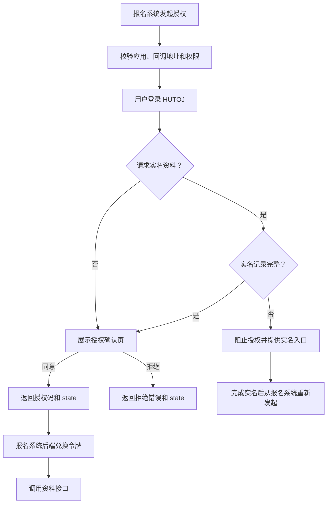

# HUTOJ OAuth 插件开发计划

确认日期：2026-11-17。状态：需求已确认，待实现。

在 `usraddons/hutoj-oauth/` 开发一个 Hydro 插件，让第三方报名系统通过用户授权获取 HUTOJ 的 UID、用户名和指定实名资料。先完成 HUTOJ 侧 API、验证用例和接入文档，再由报名系统实现接入。

本文记录已确认的业务规则和拟采用的技术方案。接口、文件结构及 CLI 操作在实现后应同步到正式文档。

## 已确认的需求

| 项目 | 约定 |
| --- | --- |
| 基础资料 | Hydro 全站 UID、用户名 |
| 实名资料 | 姓名、学号、班级、身份类型、已实名标记 |
| 实名门槛 | 请求实名资料时，必须有完整的实名记录 |
| 认证来源 | CAS 认证和管理员命令行录入均认可 |
| 未实名用户 | 阻止授权，提供实名入口；完成实名后回报名系统重新发起授权 |
| 授权确认 | 每次展示应用名称和申请字段，由用户点击同意或拒绝 |
| 实名展示开关 | 资料页公开展示与第三方授权独立；关闭展示不影响用户主动授权 |
| 访问令牌 | 默认有效期 10 分钟，不提供刷新令牌 |
| 实名变更 | 重新实名、实名资料修改或记录删除后，旧实名授权失效 |
| 应用管理 | 支持多个应用，通过插件配置或命令行管理 |

“旧实名授权失效”指变化后的下一次授权码兑换或资料请求被拒绝，需要重新发起授权。已经返回给报名系统的数据不会被远程收回。仅申请基础资料的授权不受实名状态变化影响。

本期交付范围为插件、验证用例、安装说明和 API 接入文档。报名系统的实际接入在后续完成。首版不包含应用管理后台页面、记住授权后自动通过、刷新令牌或完整 OIDC 服务。

## 现有代码与集成方式

- [实名插件](../realname-superhut/index.ts)使用 `realname_superhut` 集合保存实名资料，并提供 `getRealnameInfo(uid)`。OAuth 通过独立的实名适配层读取权威记录，不以用户表中的镜像字段作为唯一判断依据。
- 实名记录包含 `uid`、`studentId`、`className`、`realName`、`identityType`、`showRealName`、`verifiedAt` 和 `source`。其中认证时间、认证来源及展示开关不属于本期对外返回字段。
- 实名入口为 `/home/realname`。采用“完成后重新发起”的流程，默认无需修改现有实名插件的跳转逻辑。
- [Hydro 内置 OAuth 模型](../../packages/hydrooj/src/model/oauth.ts)用于接入外部登录服务。本插件新增 HUTOJ 对外授权能力，接口使用独立的 `/oauth2/` 前缀。
- 通过 `apply(ctx, config)` 注册服务和路由，从 `hydrooj` 公共入口导入 API，通过 `ctx.db` 访问数据库。

## 授权流程

采用 OAuth 2.0 授权码流程。报名系统后端保管应用密钥，负责兑换令牌和读取用户资料。

1. 报名系统生成并保存 `state` 和 PKCE 校验信息，引导用户访问 HUTOJ 授权入口。
2. HUTOJ 校验应用、回调地址、scope 和 PKCE 参数。非法应用或回调地址不能用于重定向。
3. 用户未登录时进入 Hydro 登录流程，登录后回到本次授权。
4. 请求包含实名 scope 时，检查实名记录是否完整。未实名或记录不完整则阻止授权，提供实名入口，提示完成后重新发起。
5. 页面显示应用名称、当前账号和申请字段，等待用户同意或拒绝。
6. 同意后重新检查用户、应用和实名状态，签发一次性授权码；拒绝则返回 `access_denied`。两种回调均携带原始 `state`。
7. 报名系统校验 `state`，通过后端携带授权码、应用凭据和 PKCE verifier 兑换访问令牌。
8. 报名系统通过 Bearer 令牌调用资料接口，获取授权范围内的字段。



## API 与数据范围

| 接口 | 功能 |
| --- | --- |
| `GET /oauth2/authorize` | 校验请求、引导登录、展示授权确认页或实名提示 |
| `POST /oauth2/authorize` | 处理用户同意或拒绝，成功时签发一次性授权码 |
| `POST /oauth2/token` | 兑换访问令牌 |
| `GET /oauth2/userinfo` | 根据 Bearer 令牌返回用户资料 |

scope 使用空格分隔。拟约定 `profile` 必选，`realname` 可选：

| scope | 返回字段 | 条件 |
| --- | --- | --- |
| `profile` | `uid`、`username` | 用户登录并明确同意 |
| `realname` | `realname.verified`、`realName`、`studentId`、`className`、`identityType` | 用户明确同意，且实名记录完整 |

每个应用配置允许申请的 scope。未知或超出应用许可的 scope 应返回错误，不得静默扩大权限。仅请求 `profile` 时不返回 `realname` 对象。

`profile realname` 的拟定响应：

```json
{
  "uid": 123,
  "username": "example",
  "realname": {
    "verified": true,
    "realName": "张三",
    "studentId": "202600001",
    "className": "计算机2601",
    "identityType": "学生"
  }
}
```

第三方以 UID 关联账号，用户名作为可变化的展示资料。资料接口采用字段白名单，避免返回完整用户对象或 MongoDB 文档。未满足实名条件时，不通过返回 `verified: false` 绕过强制实名要求。

正式 API 文档应明确请求编码、客户端认证方式、HTTP 状态码、成功及错误响应，以及未实名、拒绝授权、令牌过期和授权失效的处理方式。

## 应用管理与授权数据

建议以 CLI 管理应用，插件配置提供全局参数。CLI 需要支持创建应用、查看配置、修改回调地址和允许的 scope、禁用应用、重置密钥。具体命令在实现后写入安装说明。

每个应用具有独立的 `client_id`、名称、密钥摘要、回调地址白名单、允许的 scope 和启用状态。密钥只在生成或重置时显示一次。禁用应用或重置密钥后，旧授权码和访问令牌失效。

拟使用独立集合管理以下数据，不复用 Hydro 的登录会话令牌：

| 数据 | 关键内容 |
| --- | --- |
| 应用 | 应用标识、名称、密钥摘要、回调地址、scope、启用状态及凭据版本 |
| 授权请求 | 服务端保存的请求参数、登录会话绑定、确认校验值、到期时间 |
| 授权码 | 摘要、应用、用户、回调地址、scope、PKCE challenge、实名版本、到期时间 |
| 访问令牌 | 摘要、应用、用户、scope、实名版本、凭据版本、到期时间 |

授权码建议有效期 60 秒，仅能成功兑换一次；访问令牌默认有效期 600 秒。数据库使用 TTL 索引清理到期记录，所有读取仍需显式检查到期时间。授权码消费需使用原子操作，确保并发兑换不能重复成功。

## 实名变化与访问校验

在授权确认、授权码兑换、资料读取三个阶段检查实名状态。两种认证来源均认可，但姓名、学号、班级、身份类型必须完整。

签发实名授权时记录实名版本指纹，比较内容包含实名字段、`verifiedAt` 等认证信息，排除 `showRealName`。重新实名、资料变化或记录消失时拒绝旧授权；即使新的实名资料仍完整，也需要用户重新授权。

实现时验证现有实名写入方式能可靠区分认证版本；若时间戳和字段指纹不足以覆盖写入场景，应补充明确的版本标识。资料请求读取当前权威记录，不通过缓存继续接受已失效的实名授权。

基础资料授权同样需要校验账号仍然存在且可用、应用仍启用、令牌未到期。应用凭据版本变化后拒绝旧授权。OAuth 令牌仅用于本插件资料接口，不赋予 Hydro 其他接口的登录权限。

## 安全实现要求

采用授权码流程、PKCE S256 和回调地址精确匹配，参考 [OAuth 2.0 安全最佳实践 RFC 9700](https://www.rfc-editor.org/rfc/rfc9700.html)。生产回调地址使用 HTTPS；本地联调规则须在实现及文档中明确。

- 授权码绑定应用、回调地址、scope 和 PKCE 信息；兑换时检查一致性。
- 授权确认绑定登录会话并进行 CSRF 校验；服务端重新检查请求参数，不能信任隐藏表单中的权限信息。
- 第三方生成并校验 `state`，HUTOJ 原样返回。
- 授权码和令牌使用高熵随机值，数据库保存摘要。
- 资料和令牌响应禁止缓存；令牌通过 Authorization 请求头提交，不放入 URL。
- 对授权及兑换接口设置合理限流；日志不记录密钥、令牌或完整实名资料。
- API 返回稳定的 JSON 错误，避免落入 Hydro 默认 HTML 错误页或暴露内部异常。

## 实施顺序与交付物

| 阶段 | 工作 | 交付物 |
| --- | --- | --- |
| 1 | 确定接口参数、错误响应、scope 和客户端认证方式 | API 契约草案 |
| 2 | 建立插件入口、配置、数据层和索引，接入实名读取 | 插件骨架与模型 |
| 3 | 实现应用创建、配置修改、禁用和密钥重置 | CLI 管理能力 |
| 4 | 实现登录衔接、实名阻止页面和每次授权确认 | 授权页面与请求处理 |
| 5 | 实现授权码、令牌、资料读取和失效校验 | OAuth API |
| 6 | 验证协议、权限边界、并发兑换和 Hydro 页面集成 | 验证用例与结果 |
| 7 | 完善安装、管理与接入说明，核对示例可运行性 | README 和正式 API 文档 |

拟定目录：

```text
usraddons/hutoj-oauth/
├── PLAN.md
├── package.json
├── index.ts
├── src/
│   ├── model.ts
│   ├── oauth.ts
│   ├── realname.ts
│   ├── handlers.ts
│   └── cli.ts
├── templates/
│   ├── oauth_authorize.html
│   └── oauth_realname_required.html
├── test/
├── README.md
└── docs/
    └── API.md
```

## 验收标准

| 场景 | 预期 |
| --- | --- |
| 未实名用户申请 `profile` | 可以完成确认并获取 UID、用户名 |
| 未实名或实名不完整用户申请 `profile realname` | 阻止授权，提供实名入口，不签发授权码 |
| CAS 或管理员录入的完整实名用户 | 均可授权实名资料 |
| 关闭资料页实名展示 | 用户明确同意后仍可提供实名资料 |
| 用户完成实名 | 从报名系统重新发起后才能继续授权 |
| 重复发起授权 | 每次都显示确认页 |
| 用户拒绝 | 返回拒绝错误和原始 state，不签发授权码 |
| 回调地址非法、应用无效 | 不向非法回调地址重定向 |
| 未知 scope、应用越权、篡改确认表单 | 拒绝请求，不扩大授权范围 |
| PKCE 不匹配、应用或回调地址不匹配 | 兑换失败 |
| 授权码重复或并发兑换 | 最多一次兑换成功 |
| 授权码或访问令牌到期 | 即使 TTL 尚未删除记录，也拒绝使用 |
| 重新实名、修改资料或删除实名记录 | 旧实名授权的兑换和资料请求失败 |
| 仅修改展示开关 | 不使实名授权失效 |
| 应用禁用或重置密钥 | 旧授权码和访问令牌失效 |
| 账号不存在或已禁用 | 拒绝兑换和资料请求 |
| 多个应用分别授权 | 授权码、令牌和权限相互隔离 |
| 使用 OAuth 令牌访问 Hydro 其他接口 | 不获得 Hydro 登录权限 |
| API 请求失败 | 返回约定的 JSON 状态码和错误体 |

接入文档还需提供完整时序、字段说明、错误码、PKCE 与 state 的处理方法，以及可供报名系统参考的后端伪代码和 `curl` 示例。正式交付时区分语法检查、自动化验证和实际运行联调的结果。
